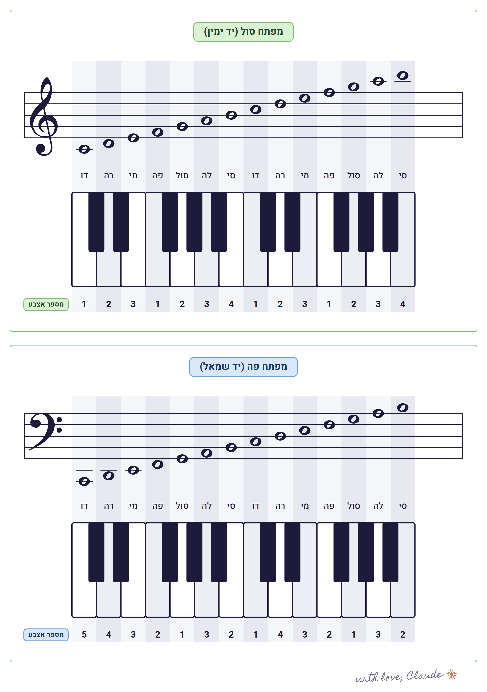

# Painting Pianos 🎹

A printable piano chart: the treble clef for the right hand (green) and the bass clef for the left hand (blue), each showing the notes, the Hebrew note names, the keys and the finger numbers.



## Build

```bash
python3 build.py            # writes painting_pianos.html
python3 build.py --png      # also exports painting_pianos.png (needs Chrome + Pillow)
python3 build.py --artifact # artifact version (no doctype/meta)
```

All settings (fingering, note names, colours, geometry) live at the top of `build.py`.
